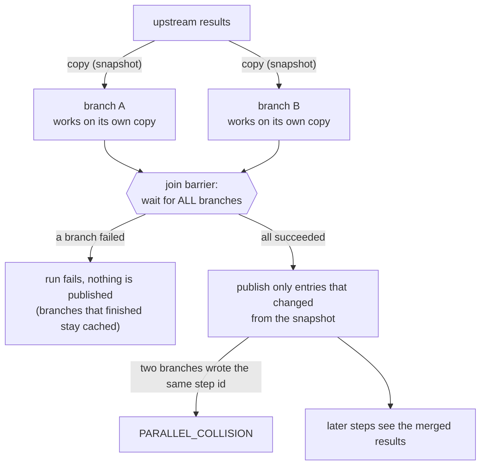
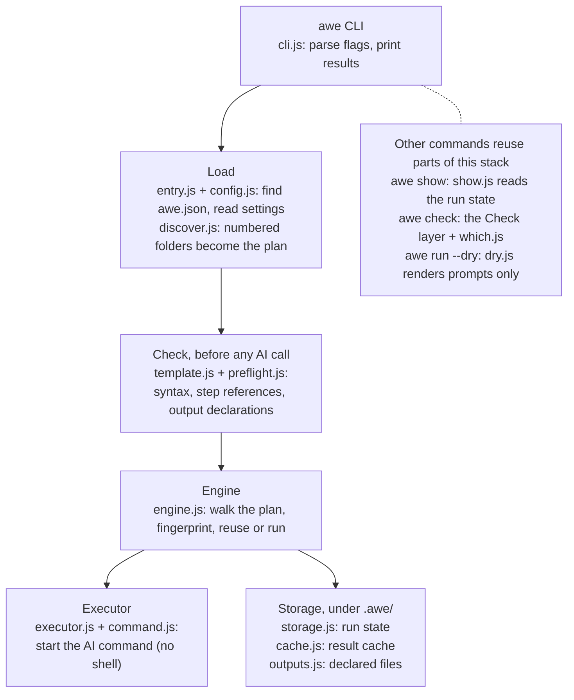
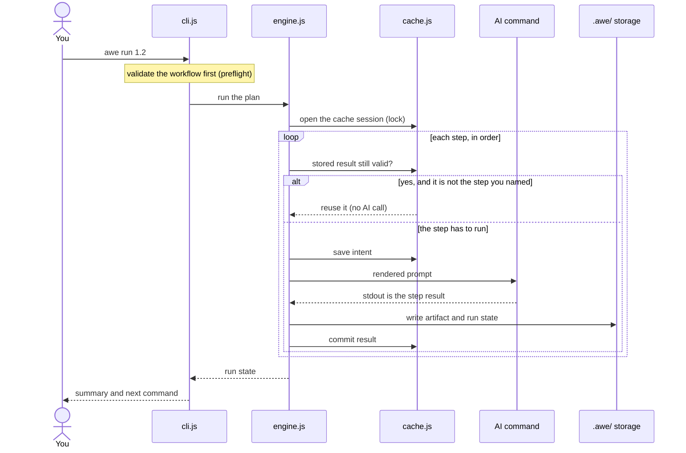

# Architecture / v0.2

## Core contract

- **Workflow** = directory containing `awe.json` and numbered prompts/groups.
- **Step** = `N.N-slug.md`. Every prompt step has a unique numeric ID and a versioned source file (via Git).
- **Group** = numbered folder or `stage-N-*` folder. Default behavior is sequential.
- **Control group** = folder containing `FLOW.json` with `type: sequence | parallel | if | until`.
- **Input** = immutable `input.key` variables provided by `awe.json` or `--var`.
- **Step output** = content emitted by a command, stored as a separate artifact.
- **Run** = immutable run identifier with state + event trace under `.awe/runs/<run-id>`. Every `awe run` is one run; its results also feed the workflow's single result cache (`.awe/cache`).
- **Executor** = a command line from `awe.json` (`run`, or a named entry of `executors`, optionally chosen per step). There is no built-in executor that fabricates output: a run without one fails with `NO_EXECUTOR`. Running a command does not prove that an AI model was used.

## Execution boundary

- The engine does not semantically judge content. A user-authored prompt may return `PASS` or `FAIL`; IF and UNTIL only match exact strings.
- A numbered prompt is a black-box task. The CLI executor is an adapter; no per-step shared conversation is assumed.
- A sequence walks children in numeric order. A parallel group forks a snapshot of its upstream context, waits for all branches, then publishes only entries changed from that snapshot (join barrier). Writes from distinct branches must have distinct IDs; replacing an earlier loop iteration's result is allowed.
- IF reads a rendered `test` expression and chooses one of two named subdirectories. UNTIL runs its children, then compares the rendered `test` expression with `equals`, and repeats up to `maxIterations` rounds until they match (`UNTIL_EXHAUSTED` otherwise). A `"type": "loop"` with `until` from before v0.3 is read as the same group and reported as a warning.
- Control routing is deterministic. Unsupported expressions fail rather than evaluate arbitrary code.
- `awe run --dry` renders prompts only (`src/dry.js`): it never starts a command, writes no run and no cache, and shows upstream results as placeholders. It cannot evaluate IF/UNTIL gates, so it shows every branch and one loop pass.
- `awe.json` marks the workflow root. Its optional `common` text (string or lines) is reusable text, not a preamble: a prompt includes it only where it writes `{{ common }}`, and the prompt a step sends is its own file, rendered, with nothing added (`runtime.js`). `common` is rendered once per use with `input` only, and is a fingerprint part only of the steps that use it; a change is reported per step as `(the common text changed)`. `awe.json` and `FLOW.json` are the only machine-enforced configuration. This avoids conflicting rules in prose. The v0.1 `ENTRY.md` is no longer read: a leftover one only produces a warning (`src/entry.js`).

*Figure: a parallel group forks a snapshot, waits for every branch (the join barrier), then publishes only what changed.*

## Variable grammar

Supported placeholders: `{{ input.topic }}`, `{{ steps["1.2"].output }}`, `{{ steps["1.2"].artifact }}`. The output reference inserts full text; the artifact reference inserts a file path. Use `artifact` for large material. No arbitrary JavaScript evaluation.

Only template source is parsed; inserted values never become template syntax. `\{{` in source emits a literal `{{`. Unsupported and unclosed expressions fail syntax checks before any command runs, and `awe check` / `awe run` also reject references to steps that are not guaranteed to exist (`src/preflight.js`).

IF and UNTIL default to exact comparison after whitespace trimming. Optional `match: first-line` strips one Markdown wrapper from the first non-blank line; `caseInsensitive` folds case. IF's optional `elseEquals` enforces a known negative verdict, failing with `IF_NO_MATCH` for unexpected text.

The CLI passes an AbortSignal to the runtime and executors for SIGINT/SIGTERM. Active steps and the run become `INTERRUPTED`; POSIX executors run in their own process groups for timeout/interruption cleanup. Executor metadata omits argument values. Rendered prompts are persisted per attempt unless `awe.json` sets `storePrompts: false`.

## Interfaces

`awe` CLI (`src/cli.js`: parsing, output) → Entry Loader (`entry.js`, `config.js`) → Directory Resolver (`discover.js`) → preflight (`template.js`, `preflight.js`) → engine (`engine.js`: walk, fingerprints, reuse) → executor (`executor.js`, `command.js`) → RunStore / cache (`storage.js`, `cache.js`). `awe show` (`show.js`) reads run state; `awe check` reuses the preflight and looks executables up on PATH (`which.js`).

*Figure: where each `src/` file sits in a run. `awe show`, `awe check` and `awe run --dry` reuse parts of the same stack.*

*Figure: one `awe run`, from the command line to the saved result.*

## Security and compatibility

- The engine does not follow symlinked workflow entries during discovery. A folder that holds no numbered prompt and no `FLOW.json` (bounded scan, using the same filename test as discovery itself) is treated as scratch space and ignored. An `awe.json` below the root is ignored and reported.
- The command string in `awe.json` is split into arguments (`command.js`) and started through `spawn(..., shell:false)`, never a shell. `{prompt}` is substituted into one argument after splitting, so prompt text cannot inject arguments or shell syntax. It inherits the user's execution permissions.
- **Only execute trusted workflows and binaries.** Prompts can instruct an external AI agent to call its own tools; AWE does not sandbox that agent.
- Version 0.1 uses `FLOW.json` to avoid implementing a partial, ambiguous YAML parser. A future YAML adapter can be added without changing flow semantics.
- No distributed workers, dynamic `goto`, automatic resume, cancellation API, credentials management, or transactional external side effects.

## Result cache and output files

User rules: [cli.md](cli.md). Engineering contract:

- **One engine.** `awe run` (a whole workflow, or one named step) is the only execution path. `src/engine.js` walks the same AST (`discover.js`), gate logic (`gateValue`), prompt builder (`buildPrompt`), executor, template renderer and `RunStore` for every run; `src/cache.js` holds the session file, lock and intent/commit; `src/outputs.js` holds named-file declaration, capture and verification.
- **Cache switch.** `options.cache` (`--cache` / `--no-cache`) decides whether valid results are *read*. Results are always *written*. The default is on when a step is named, off for a whole run. The named step itself always executes.
- **Identity.** An *address* (`<step>[@<loop>=<n>,...]`, shown to users as `<step>[@<n>.<m>]`) names one occurrence of a step; an *attempt* is one execution of it. A result's fingerprint covers the step's plan path, source, the common text (only if it writes `{{ common }}`), inputs, the step's own command line (a keyed digest; timeouts excluded), declared outputs, control path (IF branch, LOOP iteration plus a digest of the previous iteration, PARALLEL branch), the rendered prompt, and the `resultId`s of every earlier step it could see (`precontext`: lower workflow order only, so never itself or later steps). Every execution gets a new `resultId`, so a rerun invalidates dependents by cause, not by value.
- **One session file** per workflow input, replaced atomically (temp file, fsync, rename), guarded by a per-session lock file (`CACHE_BUSY`). Input and executor identity is stored as an HMAC keyed by a per-workspace salt, never as argv.
- **Commit order:** intent (retires the previous result) → command → artifact/files (exclusive create) → run state → atomic commit. Leftover intents are *unknown outcomes* and require a per-step `--retry`.
- **Output files.** Declared in `awe.json` `steps.<id>.outputs`, referenced as `steps[id].files[name]`, captured after success into an attempt-specific directory and re-verified (size + SHA-256) on every reuse. Parallel overlaps are rejected in preflight.
- **JSON output.** A step that declares `steps.<id>.json` is followed by its **formatter**, a second, separately cached unit (`convertStep` in `src/engine.js`, address `<step>~json`, listed as `1.1 json`). The step itself keeps the free-text contract. The formatter runs the top-level `formatter` command (else `steps.<id>.formatter`, else `run`) with a fixed prompt (`buildFormatPrompt` in `src/json-output.js`, versioned by `FORMAT_PROMPT_VERSION`) and `{schema}` / `{schema_file}` placeholders; its output is parsed and checked against the declaration before the step's result is complete, so a rejected output never becomes a cached result and no later step starts. The formatter's fingerprint is the step's `resultId`, the declaration, the formatter command (a keyed digest) and the prompt version, so changing the declaration reruns only the formatter and a failed formatter is the only thing `awe run --cache` runs again. Its `resultId` replaces the step's in the context, so readers of `.json` depend on both. Templates reach the JSON only through `.key` / `[n]` / `["key"]` segments over own properties (`src/template.js`); `awe check` checks syntax, that the step is declared, and that the formatter command exists.
- **Test seam.** `cli(argv, cwd, { hooks, env })` accepts `afterIntent | afterExecute | afterArtifact | afterFiles | beforeCommit | afterCommit` callbacks used by the crash tests, and `env` for executable lookup in `awe init`; neither is a public API.
