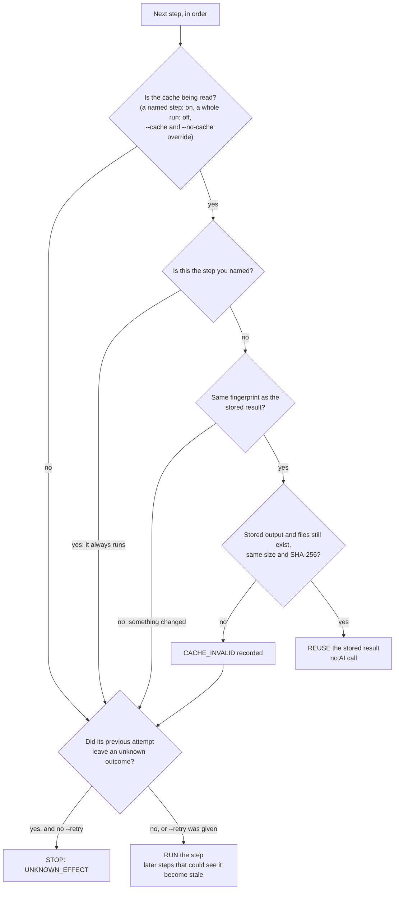
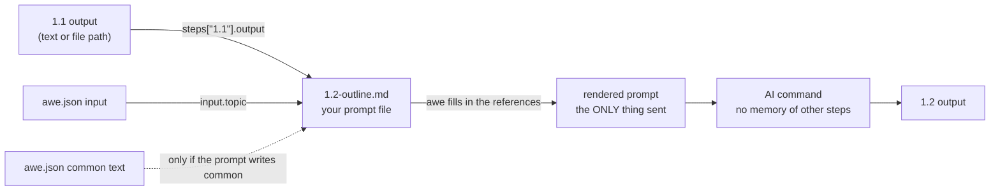
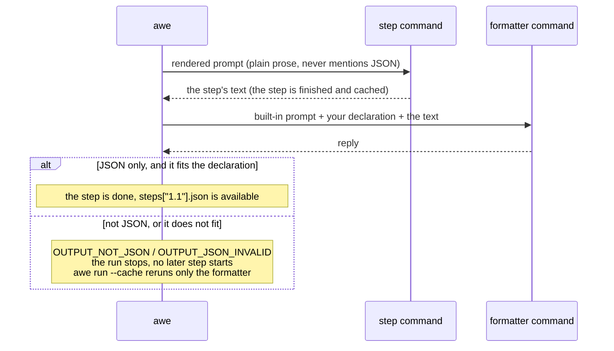
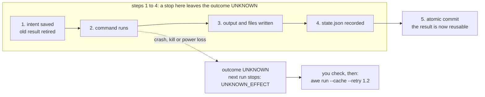
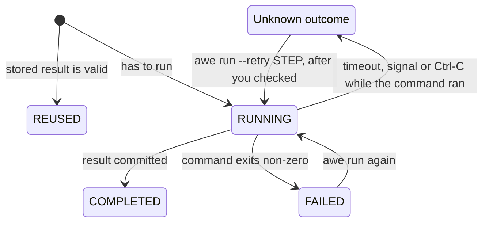

# The awe CLI

Four commands. Only `awe run` ever calls an AI command; everything else is read-only.

```text
awe init <dir>                  create a workflow (detects an AI CLI on your PATH)
awe run  [dir] [step] [flags]   run the workflow, or just one step of it
awe show [dir] [step] [flags]   look at results: output, prompt, stderr
awe check [dir]                 validate, list the steps, check the executor
```

`dir` is a workflow folder. Leave it out and awe uses the current folder, or the nearest parent that contains
`awe.json`, so every command also works from a sub-folder. `step` is a step address: `1.2`, `3.1.2`, or `2.1.1@2`
(see [UNTIL groups](#until-and-parallel-groups)). A word that looks like `1.2` is always a step, never a folder; write `./1.2`
for a folder with that name.

## Build a workflow one step at a time

A workflow grows from its first step. Run it, read the result, edit the prompt, run it again, then move on:

```sh
awe init coffee && cd coffee
awe run --dry        # preview every prompt; calls nothing
awe run 1.1          # run step 1.1
awe show 1.1         # read its output
awe run 1.1          # not happy? edit 1.1-research.md and run it again
awe run 1.2          # 1.1 comes from the cache, only 1.2 runs
awe run 1.3
awe run              # when it is ready: the whole workflow, from the start
```

Every `awe run` prints what it did:

```text
$ awe run 1.2
Workflow  coffee (6 steps in plan)    Executor  claude -p {prompt}
Cache     on — upstream reused, 1.2 always runs (--no-cache reruns everything)

  1.1     cached   14:02
  1.2     ran      18s   -> .awe/runs/2026-11-11T14-05-01-912Z-3a2162bf/artifacts/1-2-attempt-1.md
Reused 1 step · Ran 1 step
Next  awe show 1.2   ·   awe run 2.1
```

## Configure the AI command

In `awe.json`:

```json
{
  "version": 2,
  "input": { "topic": "How to choose coffee beans" },
  "run": "claude -p {prompt}",
  "timeout": 300
}
```

`run` is one command line. awe splits it into arguments (quotes work: `agent --system "be brief" {prompt}`) and starts the
program directly. **No shell is involved**, so nothing inside a prompt can be interpreted as shell syntax.

| In the command | What the program receives |
| --- | --- |
| `{prompt}` | the rendered prompt as that argument |
| `{prompt_file}` | the absolute path of the saved prompt file (`.awe/runs/<run>/artifacts/prompt-<step>-attempt-<n>.md`) |
| neither | the prompt on **stdin** |

A prompt is a Markdown file with variables; awe fills them in and saves the result before running. When it is too long to
pass as an argument (over 64 KB; 16 KB on Windows) `{prompt}` automatically becomes one line, `Read and follow the
instructions in the file: <path>`, so there is no need to write a wrapper script.

The command also receives three environment variables: `AWE_STEP` (`1.2`), `AWE_ADDRESS` (`2.1.1@2` inside an until group) and
`AWE_RUN_ID`, so a wrapper script can tell which step it is serving. The prompt itself carries no step header.

Common commands:

```text
"run": "claude -p {prompt}"
"run": "codex exec {prompt}"
"run": "opencode run {prompt}"
"run": "omp -p"                  # reads the prompt from stdin
```

`awe init` writes the first of `claude`, `codex`, `opencode`, `omp` it finds on PATH. Without a command, `awe run` stops
and shows these examples. It never pretends to have run; use `awe run --dry` to see what would be sent.

Run lines, `awe check` and error messages show the executable, plain flags, `{prompt}` and any file that exists inside
the workflow (so `node agent.cjs {prompt}` shows which agent it is); other arguments appear as `…`, so a key passed on
a command line never reaches your terminal or logs. Prefer environment variables for credentials.

### Different commands for different steps

```json
{
  "version": 2,
  "run": "claude -p {prompt}",
  "timeout": 300,
  "executors": {
    "search": { "run": "omp -p", "timeout": 900 }
  },
  "steps": {
    "1.1": { "executor": "search" },
    "2.1": { "timeout": 600 }
  }
}
```

Precedence, highest first: CLI flag (`--executor`, `--timeout`) → `steps.<id>` → the named executor → top-level `run` /
`timeout`. The default time limit is 300 seconds per step. A step that times out reports the limit, keeps the last lines
the command wrote to stderr, and suggests `awe run <step> --timeout <longer>`.

## `awe run`

| Flag | Meaning |
| --- | --- |
| `--var key=value` | override an input from `awe.json` (repeatable) |
| `--cache` / `--no-cache` | the one cache switch, see below |
| `--dry` | print the rendered prompts; call nothing, write nothing |
| `--executor <name>` | use a named executor for every step this time |
| `--timeout <sec>` | time limit for each step this time |
| `--retry <step>` | run again a step whose outcome is unknown ([recovery](#interruptions-crashes-and-unknown-outcomes)) |
| `--json` | print the run state as JSON |

Exit codes: `0` finished, `1` a step failed, `2` awe could not start (usage, configuration, workflow files),
`129`/`130`/`143` interrupted by SIGHUP/SIGINT/SIGTERM.

### Cache

One switch. Its default follows what you asked for, and the first lines of the output always say which mode ran:

| Command | Default | What happens |
| --- | --- | --- |
| `awe run 1.2` | cache **on** | steps before 1.2 are reused (run first if missing); **1.2 itself always runs** |
| `awe run` | cache **off** | the whole workflow reruns from the start |
| `--cache` | on | valid results are reused, even in a whole run |
| `--no-cache` | off | everything runs again, including the steps before the one you named |

Whatever the mode, every run stores its results, so a later `awe run 1.3` can use them.

A stored result is reused only if all of this still holds:

- the step's fingerprint is unchanged: its prompt file, the common text, inputs (`awe.json` plus `--var`), its command line
  (every argument: another `--model` is another result; timeouts are ignored), declared output files, its JSON declaration, its position
  in the workflow (including the IF branch and UNTIL iteration), and **the exact results it could see from earlier steps**;
- the stored output and every saved output file still exist and match the recorded size and SHA-256.



*Figure: the questions awe asks, in order, before it reuses a stored result or runs a step.*

| You change… | Effect |
| --- | --- |
| a step's prompt | that step and everything after it in order run again; earlier steps are kept |
| the common text | the steps that write `{{ common }}` are stale; the others are kept |
| a step's JSON declaration | that step and everything that could see its result run again |
| an input (`--var`, `awe.json`) | everything is stale, and the old results are kept under the old input |
| rerun a step (`awe run 1.2`) | everything that could see its result is stale, **even if the new output is identical** |
| a stored file or artifact | `CACHE_INVALID` is recorded; that step and its dependents run again |

A step that runs although a cache is in use says why, in brackets: `(not cached yet)`, `(the common text changed)`, `(its prompt file
changed)`, `(an earlier step ran again)`, `(its command changed)`, `(its previous attempt failed)`. A step you named, or a run
with `--no-cache`, needs no reason.

If a rerun fails, awe does not quietly fall back to the older success: later steps cannot be reused until that step
succeeds again. Old attempts stay on disk (`awe show`).

### UNTIL and parallel groups

- **sequence**: prerequisites run in order; a rerun invalidates all later steps.
- **IF**: the gate is evaluated from the (reused or fresh) results each time. If it flips, the new branch runs. Naming a
  step in the branch the gate did not select fails with `TARGET_UNREACHABLE`; nothing is executed.
- **UNTIL**: repeats its steps until a check passes (`"type": "until"`, `test`, `equals`, `maxIterations`; at most that many
  rounds, then `UNTIL_EXHAUSTED`). Every iteration is its own occurrence. `awe run 2.1.1@2` is step 2.1.1 in iteration 2 of its
  group; with nested groups list the iteration of each, outer to inner: `1.1.2.1@2.1`. Without `@`, awe uses the only occurrence it has
  seen, or asks you to choose and lists them. Rerunning iteration *k* keeps the iterations before *k*; later ones are stale.
- **PARALLEL**: branches share one upstream snapshot and publish together at the join. Naming a step inside a branch runs
  only that branch's prerequisites. If a branch fails, the siblings that succeeded are kept.
- A group such as `3.1` is not a step; awe lists the steps inside it.

Each `awe run` reads `awe.json` and every prompt once at the start; edits made while it runs apply to the next
run.

## `awe show`

```text
awe show                  the latest run: status, one line per step, stderr of a failed step
awe show 1.2              the output of step 1.2 (from whichever run last produced it)
awe show 1.2 --prompt     the rendered prompt that was sent
awe show 1.2 --err        the last lines the command wrote to stderr
awe show 1.1 --raw         only the step's own text; nothing else, so it can be piped
awe show 1.1 --formatted   only the JSON made from it (a step that declares "json"); nothing else
awe show 2.1.1@2          one UNTIL iteration (same address form as `awe run`)
awe show --run <id>       a specific run (default: the latest)
awe show ... --json       the stored state
```

## `awe check`

Validates the common text, every prompt and flow file (template syntax, references to steps that are not guaranteed to
exist, IF/UNTIL settings, output declarations), prints the plan, and looks each configured executable up on PATH. A
workflow with a problem fails with exit `2`. A missing executor is reported (`NOT READY`, and `"ready": false` with `--json`) but does not fail the check, so a CI machine without an AI CLI can still validate workflows.

## `awe run --dry`

Renders every prompt without calling anything. References to earlier results show as `[output of 1.1]` and
`[file report of 1.1]`; every IF branch is shown, and an UNTIL body once. Nothing is written: no run, no cache. A dry run
checks wiring and wording; it says nothing about what a model will answer.

## Common text (`"common"` in `awe.json`)

A workflow is a folder that holds `awe.json` (it can be as small as `{ "version": 2 }`); awe finds it from any sub-folder by
walking up. `"common"` is optional text you want to reuse in several prompts: who the AI is working as, the audience, tone,
rules ("never invent sources"), the output format. It is **not** added to anything automatically. A prompt includes it
where, and only where, it writes `{{ common }}`:

```json
{
  "version": 2,
  "input": { "topic": "tea" },
  "common": [
    "Only reply in zh-TW.",
    "You write for beginners about {{ input.topic }}."
  ]
}
```

```md
<!-- 1.3-final.md -->
{{ common }}

Write the final checklist, one step per line.
```

| | |
| --- | --- |
| **What a step sends** | its own prompt file, rendered, and nothing else: no header, no preamble. `awe show 1.3 --prompt` prints exactly that. With the example above the step sends `Only reply in zh-TW.` / `You write for beginners about tea.` / a blank line / `Write the final checklist…`. |
| **Form** | a string, or an array of lines (joined with newlines; easier to read than one long string). Leading and trailing whitespace is trimmed. |
| **Where** | anywhere in a prompt, any number of times, in any position: first line, last line, inside a sentence. The spelling is fixed: `{{ common }}` (spaces optional). |
| **Variables** | it is rendered like a prompt, so `{{ input.topic }}` works. It cannot use `{{ steps[...] }}` (any step may use it, including the first, where nothing has run yet) or `{{ common }}` itself. Put step references in the step's own prompt. |
| **Mistakes** | `{{ common }}` in a prompt but no `"common"` in `awe.json`: error at `awe check`. `"common"` defined but no prompt writes it: warning, because it is sent nowhere. |
| **Only the root one** | an `awe.json` in a sub-folder (`stage-2/awe.json`) is **not** used for that folder's steps. `awe check` / `awe run` warn about it. Running awe from inside `stage-2/` would treat that folder as its own, separate workflow. |

Every step is its own AI call with no memory of the others, so a step that writes `{{ common }}` sends it with that call: a
hundred such steps send it a hundred times, once per call, never accumulating. Steps that do not write it do not pay for it.
Keep it short because of that cost, not because of how it is written. `awe check` prints how many steps use it.

Lifecycle:

1. `awe init` writes a starting `"common"`, and its prompts start with `{{ common }}`.
2. `awe check` validates its syntax and references and prints its size and which steps use it. It warns above 4,000 characters.
3. Each `awe run` (and `awe run --dry`) reads it once at the start and renders it into the prompts that write `{{ common }}`.
4. Only those steps depend on it: **editing it, even a comma, makes exactly the steps that write `{{ common }}` stale**, and
   the next run that uses the cache says so on each one it reruns: `1.3  ran  18s  (the common text changed)`.
5. Run outputs keep the rendered prompt per attempt, so the exact text that was sent stays inspectable.

Rule of thumb: if several prompts need the same text, put it in `"common"` and write `{{ common }}` where it belongs; if one
prompt needs it, write it in that prompt; if it changes between runs, put it in `input` (`--var`).

There is no file for this on purpose: v0.1's `ENTRY.md` did two jobs under a misleading name (root marker and shared text),
and a `COMMON.md` would only rename the problem. A leftover `ENTRY.md` is not used; `awe check` / `awe run` warn about it, and a
folder that has an `ENTRY.md` but no `awe.json` is rejected with the ready-to-paste `awe.json` (its lines already
escaped as JSON). There is no `awe migrate` command: it is a one-time step, and the message already contains its result.
With `--json`, such warnings are also in the output as `"warnings"`.

## Order, and what a step receives

Steps run in numeric order, not file-name order: `1.1`, `1.2`, then everything in `stage-2/` (`2.1`, `2.2`), then `10.1` after
`9.1`. A plain folder is a sequence; `FLOW.json` turns it into `parallel`, `if` or `until`. A folder needs a numeric
prefix (`2.1-review/`) or a `stage-N` name (`stage-2/`): a folder just called `2/` that holds prompts is rejected, with
the name to use instead.

A step receives exactly one thing: its own prompt, with `{{ … }}` filled in (including `{{ common }}`, if it writes it). It does not
receive earlier steps' prompts or outputs, and the AI keeps no memory between steps. To use an earlier result, name it in
the step's prompt: `{{ steps["1.1"].output }}` (the text) or `{{ steps["1.1"].artifact }}` (the file path).



*Figure: a step receives only its own rendered prompt. Earlier results, `input` and `common` reach it only through the `{{ ... }}` references you write.*

## Workflow files

Unchanged: numbered `N.N-name.md` prompts, `FLOW.json` for `parallel` / `if` /
`until` groups, and `{{ input.x }}` / `{{ steps["1.1"].output }}` / `{{ steps["1.1"].artifact }}` /
`{{ steps["1.1"].files["name"] }}` references. See the [README](../README.md).

A folder inside the workflow is part of it only if it is a numbered or `stage-N` folder, or holds a `FLOW.json` or a numbered
prompt somewhere below. Any other folder (`out/`, `state/`, a `notes/` folder of plain Markdown that a step created) is
ignored, so scratch space written by a command never turns a working workflow into one that cannot be checked or run. A
folder that does hold numbered prompts but is not itself numbered fails with `INVALID_STEP` and says how to rename it. Plain
files are different: a non-numbered `.md` file in a workflow folder is still an error, so declare files a step writes
there under `steps.<id>.outputs`, or write them into a dot-folder such as `.state/`.

## Output files

Besides text, a step can produce files such as PDFs or images. A declared output is a file the step's **own command writes**;
awe checks that it was written by this attempt and keeps a copy. awe never creates one from the step's answer. To save a
step's **JSON answer** as a file, do not write a script and a second step: use [`jsonFile`](#saving-the-json-as-a-file).
Declare outputs per step in `awe.json`:

```json
{
  "version": 2,
  "run": "node make-report.js",
  "steps": {
    "1.1": { "outputs": [{ "name": "report", "path": "out/report.pdf" }] }
  }
}
```

and reference the saved copy by name from later steps (and from IF/UNTIL expressions):

```md
Review the PDF at {{ steps["1.1"].files["report"] }}
```

How it works:

1. The command runs with the workflow directory as its working directory and writes the file at the declared path.
2. Before it starts, awe notes what is at that path. After it succeeds the file must exist, be a regular file inside the
   workflow (symlinks that leave it are refused) and **must have been written by this attempt**: an unchanged file fails
   the attempt with `OUTPUT_STALE`, a missing file with `OUTPUT_MISSING`.
3. awe copies each file to `.awe/runs/<run-id>/artifacts/files/<step>/attempt-<n>/<name><ext>`, records its size and
   SHA-256 and makes it read-only. Copies are created exclusively, so a later attempt never overwrites an earlier one.
   Later steps read the copy.
4. Reuse re-verifies the copies; a tampered, resized or missing copy invalidates the cache entry.

Everything is validated before any command starts: paths are relative, forward-slash, inside the workflow and outside
`.awe`; names are unique per step; every `files[...]` reference names an output of a step that is guaranteed to have run.
Parallel steps may not declare the same location (`OUTPUT_CONFLICT`, also through symlinks). A declared output may not go
through a symlink at all (`OUTPUT_INVALID`). Discovery skips each declared file and the generated folders leading to it,
so generated files never count as steps. Only named files are supported: no directories, no wildcards.

## JSON output

Some steps should hand something structured to the next ones: a title and a description, three roles. Keep the two jobs
apart. The step answers in plain prose, with a prompt that never mentions JSON; **a second command, the formatter**, turns
that text into the JSON you declared; awe checks the result **before the step counts as done**. Later prompts then read
parts of it, and a bad answer stops the workflow where it happened. You write one thing, the declaration in `awe.json`:

```json
{
  "version": 2,
  "run": "claude -p {prompt}",
  "formatter": "codex exec --output-schema {schema_file} {prompt}",
  "steps": {
    "1.1": {
      "json": {
        "type": "object",
        "required": ["title", "description"],
        "additionalProperties": false,
        "properties": {
          "title": { "type": "string", "description": "a short title" },
          "description": { "type": "string" }
        }
      }
    }
  }
}
```

`1.1-story.md` just says what to write: *"Generate a title and a description for the story."* A later prompt reads the result:

```md
Title: {{ steps["1.1"].json.title }}
About: {{ steps["1.1"].json.description }}
```

`{{ steps["1.1"].output }}` is still the step's own text, and `{{ steps["1.1"].artifact }}` its file. `.json` is what the
formatter made of it.

### What happens

For a step that declares `"json"`, awe runs **one more command call**, right after the step:

1. the step runs as usual and finishes with its text;
2. awe runs the **formatter** with a fixed, built-in prompt (the rules, your declaration as a JSON Schema, and the step's text
   between `--- TEXT START ---` / `--- TEXT END ---`). The prompt cannot be changed: one wording means every tool behaves alike;
3. the formatter's output must be JSON **only** and must fit the declaration. Then the step is done, and `.json` is available.



*Figure: a step with a `json` declaration costs one extra formatter call, and a bad answer stops the run right there.*

`awe run` lists the formatter under its step, so its time, whether it came from the cache, and its own failure are visible:

```text
  1.1      ran      18s   -> .awe/runs/…/artifacts/1-1-attempt-1.md
  1.1 json ran       4s   -> .awe/runs/…/artifacts/1-1-json-attempt-1.md
Reused 0 steps · Ran 3 steps   (1 JSON formatter run included)
```

This is one more call, so one more bill. `awe run --dry` shows the formatter prompt (`1.1 json`) with the step's text as a
placeholder, and `awe check` lists the formatter command next to the others.

### The formatter command

Set it once, at the top level of `awe.json`, written like `run`; a step can override it:

```json
{ "formatter": "claude -p {prompt}", "steps": { "1.1": { "json": true, "formatter": "codex exec {prompt}" } } }
```

Precedence: `steps.<id>.formatter` → top-level `formatter` → `run`. Without a `formatter`, the `run` command is used, so it
works out of the box: **write `formatter` only when it should be a different command** (do not repeat `run`). If `awe.json` has no `run` either, the step's own executor makes its JSON (a step that names an
executor is not asked to configure a second command). The formatter has the same `{prompt}`, `{prompt_file}` and stdin rules
as `run`, plus two placeholders that only it has:

| Placeholder | Value |
| --- | --- |
| `{schema}` | the declaration as JSON text (for flags such as claude's `--json-schema`) |
| `{schema_file}` | a file holding that text, under `.awe/runs/<run>/artifacts/` (for flags such as codex's `--output-schema`) |

A tool's own structured-output flag is optional, because the checks are awe's. `claude` has `--json-schema` and `codex exec`
has `--output-schema`; `opencode run --format json` and omp's JSON mode print an event stream, not an answer that fits a
schema, so there the built-in prompt does the work. A flag only helps if the schema suits the tool: OpenAI's strict mode, for
example, wants `"additionalProperties": false` on objects, which is why that keyword is supported. `{schema}` and
`{schema_file}` in `run` or `executors` are rejected. The environment variables `AWE_STEP`, `AWE_ADDRESS` (`1.1 json`) and
`AWE_RUN_ID` are set for the formatter too. Its time limit is the step's (`steps.<id>.timeout`, else `timeout`, `--timeout`).

### The declaration

`"json": true` means "any valid JSON". Otherwise a small subset of JSON Schema; any other key is rejected when `awe.json` is
read, so a typo is never silently ignored:

| Key | Meaning |
| --- | --- |
| `type` | `object`, `array`, `string`, `number`, `integer`, `boolean`, `null` (or a list of them) |
| `minItems`, `maxItems` | array length; both `3` means exactly three |
| `items` | a declaration every array item must satisfy |
| `required` | field names an object must have |
| `properties` | declarations for named fields, applied when the field is present |
| `additionalProperties` | `false`: fields not listed in `properties` are errors |
| `enum` | the allowed values |
| `description` | only a hint for whoever makes the JSON (it is in the formatter prompt); not checked |

### Reading values

A path is `.key`, `[0]` or `["key with spaces"]`, one after another. A string is inserted as it is, a number or boolean as
its text, an object or array as compact JSON (so `{{ steps["1.1"].json }}` is the whole value). There is no arithmetic, no
calls and no other syntax: a template cannot run code. A missing key or an index past the end is an error that names the
place: `There is no "perspective" at json[1] (it has: role)`, `Index 2 is out of range at json: the array has 2 items`. The same
paths work in `FLOW.json` gates: `"test": "{{ steps[\"2.1\"].json.verdict }}"`. With three parallel steps reading `[0]`, `[1]`
and `[2]` of one step's JSON, each branch gets its own item.

### When it fails

The formatter's output must be JSON **alone**: a Markdown code fence, or any text before or after it, is `OUTPUT_NOT_JSON`
(and the message says which). A mismatch is `OUTPUT_JSON_INVALID` with paths, for example `$ must have exactly 3 items, got 2`
or `$[1].perspective is required`. A formatter that cannot run fails like any command (`EXECUTOR_FAILED`, `EXECUTOR_TIMEOUT`).
In every case the run stops, **no later step starts** (a parallel group after it never forks), and what the formatter returned
stays saved:

```text
  1.1      ran      18s   -> .awe/runs/…/artifacts/1-1-attempt-1.md
  1.1 json FAILED   The JSON made by the formatter of step 1.1 does not match its declaration in awe.json:
             $[1].perspective is required
           The formatter's output is saved in .awe/runs/…/artifacts/1-1-json-attempt-1.md
Next  awe run --cache   (1.1 comes from the cache, so only its formatter runs again; …)
```

The step itself is finished and cached, so **recovering costs only the formatter**: fix the declaration or the formatter command,
then `awe run --cache`. No retry loop is built in: each failure is visible, and you decide whether to try again. A formatter that was
stopped or timed out may have acted, so awe will not resend it on its own: `--retry 1.1` (the same flag as for the step) covers both.

### Showing it

`awe show 1.1` prints the step's text, then what the formatter made of it (or, when rejected, what it returned):

```text
── output ──
Title: The Fox. About a fox who learns to share.

── json ──
{"title":"The Fox","description":"About a fox who learns to share"}
```

`awe show 1.1 --prompt` and `--err` print both sections too. Steps without a declaration print as before.

To take just one part, for a pipe or a file: `awe show 1.1 --formatted > roles.json` (only the JSON) and `awe show 1.1 --raw`
(only the step's own text). Without `jsonFile`, the JSON otherwise lives only inside the run folder
(`.awe/runs/<run>/artifacts/1-1-json-attempt-<n>.md`): a different path every run, and not a `.json` file.

### Saving the JSON as a file

To get the checked JSON as a real file in the workflow (for another tool, for git, for a person), say where, next to
`"json"` in the same step:

```json
{
  "steps": {
    "1.1": {
      "json": { "type": "array", "minItems": 3, "maxItems": 3 },
      "jsonFile": "output/roles.json"
    }
  }
}
```

That is all: no script, no second step, no `executors`, no `outputs`. After the formatter's answer has been checked, awe writes it
to that path, pretty-printed (2 spaces, a final newline) and replaced atomically. `awe run` shows where it went
(`1.1 json  ran  4s  -> output/roles.json`), and `awe show 1.1` labels the section `json (saved: output/roles.json)`.

- **Only checked JSON is written.** If the formatter's answer is rejected, the file is left exactly as it was (an earlier valid
  result, or absent): it never holds anything the declaration would have refused. Because the step is checked **before** it counts
  as done, a script or tool that reads the file does not need to check the shape again.
- **The file always matches the result in use.** A cached run puts it back if it was deleted or edited, without asking the model
  again, and leaves it untouched when it is already correct. awe owns this file: edits to it are overwritten.
- **Putting `jsonFile` in `"json"` is a mistake** (`"json": { "file": … }`); the error says where it goes. `jsonFile` needs
  `"json"` in the same step.
- The path follows the same rules as a declared output (relative, inside the workflow, not under `.awe`, no wildcards, no symlinks
  on the way). Two steps may not use the same path, nor the path of a declared output (`OUTPUT_CONFLICT`).
- It is not part of the cache identity: moving the file to another path writes it there, and does not rerun the formatter.

### Checks and cache

`awe check` verifies the syntax of every JSON reference, that the step it reads is declared (and runs earlier), and that the
formatter command exists; the data does not exist yet, so it is checked when the step runs. The formatter is cached on its own,
keyed by the step's result, the declaration, the formatter command and the built-in prompt:

- changing the declaration or the formatter command reruns **only the formatter** (`(its JSON declaration changed)`,
  `(its formatter command changed)`), never the step before it;
- `awe run 1.1` runs the step, and so its formatter runs again (`(the step's text changed)`);
- removing the declaration drops the formatter; the step stays cached;
- a stored formatter result that was edited, or no longer fits the declaration, is rerun instead of reused.

**Limits.** The number of parallel branches is still written in `FLOW.json`: this reads values out of one answer, it does not
create a branch per array item (a dynamic `foreach` would be a separate feature). The formatter prompt is not configurable.

## Interruptions, crashes and unknown outcomes

Writes happen in a fixed order so that a crash can never produce a result that looks valid:

1. A durable **intent** for the attempt is committed to the cache (this also retires the previous result).
2. The command runs.
3. The text artifact and output files are written to the attempt's own location.
4. The attempt is recorded in the run's `state.json`.
5. A single atomic file replace commits the result to the cache. Only this makes it reusable.



*Figure: the write order. A stop anywhere before step 5 can never leave a result that looks valid; it leaves an unknown outcome you resolve with `--retry`.*

One `awe run` uses the cache at a time; a second one fails with `CACHE_BUSY` (the lock of a dead process on the same host
is taken over automatically).

If a run stops after the command may have started but before its result was committed (Ctrl-C, a timeout, a signal from
outside such as the OOM killer, a crash or power loss), the effects of an external command are **unknown**. awe never resends
such a command on its own, and does not claim exactly-once execution. The next run stops with `UNKNOWN_EFFECT` and prints
what to do once you have checked what the command may have changed:

```sh
awe run --cache --retry 1.2
```

`--retry` lets that one step run once. A plain non-zero exit is a known failure and needs no `--retry`; a command killed by
a signal is not (its error says `terminated by signal …`). A run that a crash left unfinished is marked `FAILED`
(`RUN_ABANDONED`) the next time the cache is opened.



*Figure: the life of one step attempt. A step killed or timed out is saved as `INTERRUPTED` / `FAILED` and marked unknown; awe will not resend it until you pass `--retry`.*

```mermaid
stateDiagram-v2
    direction LR
    [*] --> RUNNING: awe run starts
    RUNNING --> COMPLETED: every step finished (exit 0)
    RUNNING --> FAILED: a step failed (exit 1)
    RUNNING --> INTERRUPTED: SIGINT, SIGTERM or SIGHUP (exit 130, 143, 129)
    RUNNING --> FAILED: the process crashed; marked RUN_ABANDONED the next time the cache is opened
```



*Figure: the status of a whole run, with the exit code `awe run` returns.*

## What is stored

```text
.awe/
  cache/.salt                           random per-workspace key (mode 0600)
  cache/<session>/session.json          cached results and a short history per step; a lock while in use
  runs/<run-id>/state.json              one record per `awe run`: executed/reused steps, inputs, errors, stderr tail
  runs/<run-id>/artifacts/...           text outputs, prompts and saved output files, one location per attempt
```

`.awe/` is for you: add it to `.gitignore`. It holds inputs, rendered prompts and outputs, so keep it private.
awe does **not** store command lines or credentials in the cache: the executor and the inputs are keyed digests (HMAC with
the per-workspace salt). Set `"storePrompts": false` in `awe.json` to keep prompts only for the moment a command needs them
(`awe show <step> --prompt` then has nothing to show).

## Limits

- awe does not track other files a step reads, environment variables or external services. If something outside the
  declared inputs changes, rerun the step by name (`awe run 1.2`), or start over with `--no-cache`.
- The cache identity trusts the command line as written; the behaviour of the program it launches is not versioned.
- The lock uses process IDs, so it protects one machine only.
- Mid-step output is not resumable: an interrupted step runs again from its start.
- Nothing prunes `.awe/runs` or `.awe/cache`, and every run that executes steps writes new artifacts, prompts and saved files (a whole run ignores the cache by default, so it rewrites the same artifacts under a new run id). Delete `.awe/` to reclaim space; the next run starts a fresh cache. Cached results point into the run folders that produced them, so deleting only some old runs is safe but makes the steps that lived there run again.
- A step inside an `until` group cannot see which iteration it is in: there is no `{{ loop.iteration }}`, and no for-each over a JSON array yet (it would be a separate feature). `@n` addresses an iteration from the outside (`awe run 2.1.1@2`), but a prompt that should behave differently in round 2 has to read the previous step's output. A template variable for it is a possible follow-up, not part of v0.2.
- There is no built-in search or token budget. Put one in your prompt ("at most 5 searches") and give slow, tool-using
  steps a longer `timeout`.

## Errors

| Code | Meaning |
| --- | --- |
| `CLI_USAGE` | a flag or argument is wrong; the message lists the valid forms |
| `NO_EXECUTOR`, `UNKNOWN_EXECUTOR` | no command configured, or `--executor` named one that does not exist (lists the names) |
| `INVALID_CONFIG` | `awe.json` has a problem; the message names the key |
| `WORKFLOW_NOT_FOUND` | not inside a workflow; use `awe init <dir>`, `cd` into one, or pass the folder |
| `STEP_NOT_FOUND` | no such step, or the address names a group (lists the valid steps) |
| `ITERATION_REQUIRED` / `ITERATION_INVALID` | `step@n` is ambiguous, malformed or out of range |
| `TARGET_UNREACHABLE` | the gate or until group never reaches that step; it was not executed |
| `UNKNOWN_EFFECT` / `RETRY_UNKNOWN` | see [recovery](#interruptions-crashes-and-unknown-outcomes) |
| `CACHE_BUSY` | another `awe run` is using this workflow's cache |
| `EXECUTOR_TIMEOUT`, `EXECUTOR_FAILED`, `EXECUTOR_ERROR` | the command timed out, exited non-zero, or could not start |
| `OUTPUT_MISSING`, `OUTPUT_STALE`, `OUTPUT_INVALID`, `OUTPUT_CONFLICT` | see [output files](#output-files) |
| `OUTPUT_NOT_JSON`, `OUTPUT_JSON_INVALID` | the formatter of a step that declares JSON answered with something else, or with JSON that does not fit; see [JSON output](#json-output) |
| `RUN_NOT_FOUND`, `PROMPT_NOT_STORED` | `awe show` has nothing to show |
| `NO_JSON_OUTPUT` | `awe show <step> --formatted` on a step that declares no `"json"`, or whose formatter has no result |

## Upgrading from v0.1

| v0.1 | Now |
| --- | --- |
| `awe simulate`, `--executor echo`, the default echo executor | `awe run --dry`; a run without an executor fails with examples |
| `awe dev … --step 1.2` | `awe run 1.2` |
| `awe dev` (finish the workflow) | `awe run --cache` |
| `--fresh` | `--no-cache` |
| `--executor command --command X --arg Y` | `"run": "X Y"` in `awe.json` |
| `--acknowledge <step>` | `--retry <step>` |
| `--invocation loop=2` | `step@2` |
| `awe status`, `awe inspect`, `awe explain` | `awe show` |
| `awe validate`, `awe plan` | `awe check` |
| `awe init --template content --out DIR` | `awe init DIR` |
| `ENTRY.md` (root marker, and text added to every prompt) | `awe.json` marks the root; the shared text is its `"common"` field, which a prompt includes with `{{ common }}` (nothing is added automatically). `ENTRY.md` is no longer used: a leftover one is reported, and a v0.1 folder without `awe.json` is rejected with the migration steps |

The old `executor: { type, argv, timeoutMs }` block in `awe.json` still works and prints a deprecation warning with the
replacement; `"type": "echo"` no longer exists. Old `.awe/runs` and `.awe/dev` folders are neither read nor deleted; `.awe/dev` (the v0.1 cache) is no longer used and is safe
to delete.
